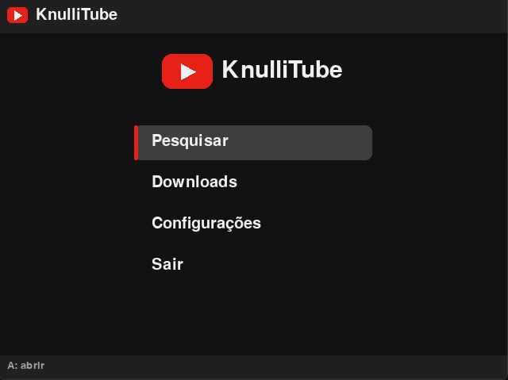

<div align="center">

# 📺 KnulliTube

**Assista e baixe vídeos do YouTube direto no seu handheld com Knulli.**


*by: freelipeez*

</div>

---

## ✨ O que é

O **KnulliTube** é um app em Python feito para consoles portáteis que rodam **[Knulli](https://knulli.org)**. Ele traz o YouTube para o seu handheld, com uma interface pensada para controle: teclado na tela, listas com miniaturas e atalhos nos botões.

A ideia nasceu do [MuTube](https://community.muos.dev/t/mutube-1-0-9-youtube-player-downloader-for-muos/1621), um app parecido para o muOS. O KnulliTube é um projeto independente, escrito do zero para o Knulli.

> 🎮 Desenvolvido e testado no **TrimUI Smart Pro** (tela 16:9). Em outros aparelhos pode precisar de pequenos ajustes, principalmente no mapeamento dos botões.

## 🖼️ Capturas de tela

<p align="center">
  
  
</p>

*(em breve)*

## 🚀 Recursos

- 🔎 **Busca** com teclado na tela, navegado pelo D-pad
- 🖼️ **Resultados com miniatura**, título, canal e duração
- ▶️ **Reprodução** de vídeos com o `mpv`, com preferência por **H.264** (o que aparelhos fracos decodificam melhor)
- ⬇️ **Downloads** para assistir offline, com barra de progresso
- 📂 **Tela de Downloads** para reproduzir ou apagar o que já foi baixado
- ⚙️ **Configurações**: qualidade (360p a 1080p), ação do botão A e modo do player de vídeo
- 🔄 **yt-dlp automático**: instala sozinho na primeira abertura e atualiza com um clique
- 🎛️ **Controle durante o vídeo**: pausar, avançar, volume, legenda e sair, tudo pelos botões
- 📶 **Modo offline**: sem internet, o app abre direto nos vídeos baixados
- 🖥️ **Interface 16:9**, ajustada para a tela do Smart Pro

## 📦 Requisitos

Tudo isso já costuma vir na imagem do Knulli:

| Item | Observação |
|---|---|
| **Python 3** com **pygame** | testado com Python 3.12 e pygame 2.5 |
| **mpv** | usado para tocar os vídeos |
| **Internet (Wi-Fi)** | para buscar, assistir e baixar |

O **yt-dlp não precisa ser instalado por você**: o app baixa na primeira abertura.

## 🔧 Instalação

1. **Baixe** este repositório (botão *Code → Download ZIP*) e extraia.
2. Copie para o cartão do aparelho, na pasta de **Ports**:
   - a pasta `knullitube/`
   - o arquivo `YouTube.sh`

   ```
   /userdata/roms/ports/
   ├── YouTube.sh
   └── knullitube/
       ├── main.py
       └── ...
   ```
3. No EmulationStation, **atualize a lista de jogos** (*Menu → Opções de jogo → Atualizar lista de jogos*).
4. Abra **YouTube** na categoria **Ports**.
5. Na **primeira abertura**, aguarde a instalação do yt-dlp. É rápido e só acontece uma vez.

> 💡 Se o `YouTube.sh` não abrir, confirme que ele usa quebra de linha Unix (LF) e tem permissão de execução (`chmod +x YouTube.sh`).

## 🎮 Controles

### Nos menus

| Botão | Ação |
|---|---|
| **D-pad** | navegar |
| **A** | confirmar / abrir / digitar |
| **B** | voltar / apagar letra |
| **X** | baixar (resultados) · apagar (downloads, aperte duas vezes) |
| **Y** | espaço (teclado) |
| **START** | buscar / baixar |

### Durante o vídeo

| Botão | Ação |
|---|---|
| **A** | pausar / continuar |
| **B** | **sair do vídeo** |
| **X** | ligar/desligar legenda |
| **Y** | mudo |
| **L / R** | voltar / avançar 60 s |
| **D-pad ← →** | voltar / avançar 10 s |
| **D-pad ↑ ↓** | volume +5 / −5 |

## ⚙️ Configurações

Dentro do app, em **Configurações**:

- **Qualidade**: 360p, 480p, 720p ou 1080p. O padrão é **480p**, que roda bem em aparelhos com processador fraco.
- **Botão A na lista**: escolhe se o A reproduz ou baixa.
- **Player de vídeo**: *Automático* ou *SDL (compatível)*. Se a tela ficar preta ao abrir um vídeo, troque para SDL.
- **Atualizar yt-dlp**: baixa a versão mais recente. Faça isso se as buscas ou vídeos começarem a falhar, o YouTube muda com frequência.

As opções ficam salvas em `knullitube/config.json`.

## 🧠 Como funciona

```
Busca ──► yt-dlp ──► lista de resultados
                          │
                  A (reproduzir)
                          ▼
        yt-dlp -j  ──►  links diretos de vídeo + áudio
                          │
                          ▼
                 mpv (toca em tela cheia)
                          ▲
   /dev/input/js0 ──► PadBridge ──► comandos via socket IPC
```

Algumas decisões que valem registro, porque custaram horas de depuração:

- **Os links são resolvidos pelo app, não pelo mpv.** O mpv do Knulli é compilado **sem Lua**, então a integração nativa com o yt-dlp não existe. O app pede os links ao yt-dlp e entrega ao mpv já prontos, junto com o *User-Agent* certo.
- **O controle não usa o suporte a gamepad do mpv.** No Knulli, `--input-gamepad` ocupa o SDL e impede o vídeo de abrir. Em vez disso, o app lê o controle direto de `/dev/input/js0` e manda comandos ao mpv por um socket (`--input-ipc-server`).
- **H.264 primeiro.** O seletor de formato prioriza `avc1`, porque VP9 e AV1 pesam demais para a decodificação por software desses aparelhos.

## 🗂️ Estrutura do projeto

```
.
├── YouTube.sh            # lançador (fica na pasta de Ports)
├── knullitube/
│   ├── main.py           # o app inteiro
│   ├── bin/              # o yt-dlp é instalado aqui
│   └── downloads/        # vídeos baixados
├── docs/                 # capturas de tela
├── LICENSE
└── README.md
```

Arquivos gerados durante o uso (`log.txt`, `mpv.log`, `config.json`) ficam fora do Git, pelo `.gitignore`.

## 🩺 Solução de problemas

<details>
<summary><b>O app abre e volta para o menu</b></summary>

Abra `knullitube/log.txt`. O erro quase sempre aparece nas últimas linhas. Confira também se a pasta `knullitube/` está ao lado do `YouTube.sh`.
</details>

<details>
<summary><b>Tela preta ao abrir o app</b></summary>

Pode haver um `mpv` esquecido segurando a tela. Reinicie o aparelho (ou rode `killall mpv` por SSH). O app já encerra qualquer `mpv` sobrando ao iniciar.
</details>

<details>
<summary><b>O yt-dlp não instala</b></summary>

Verifique a conexão Wi-Fi e a **data e hora do aparelho** (data errada quebra a verificação de certificados). O motivo exato fica no `log.txt`. Na tela de instalação, **A** tenta de novo e **B** continua sem yt-dlp.
</details>

<details>
<summary><b>O vídeo trava, fica preto ou sem imagem</b></summary>

1. Em **Configurações**, deixe a qualidade em **480p** (ou menos).
2. Troque o **Player de vídeo** para **SDL (compatível)**.
3. Espere uns segundos: o mpv abre dois links (vídeo e áudio) e pode demorar a mostrar a imagem.
4. Se persistir, veja o `mpv.log`.
</details>

<details>
<summary><b>Os botões estão trocados</b></summary>

O mapeamento fica em `Input.BTNS` (menus) e `PadBridge.BTN` (durante o vídeo), no `main.py`. Cada botão apertado é registrado no `log.txt`, então dá para descobrir os números do seu aparelho e ajustar.
</details>

Teclado: setas, `Enter` = A, `Esc` = B, `X`, `Y`, `Espaço` = START.

Variáveis úteis: `KT_W` e `KT_H` mudam a resolução lógica da interface (padrão 854×480).

## 🗺️ Ideias para o futuro

- [ ] Retomar o vídeo de onde parou
- [ ] Histórico e favoritos
- [ ] Fila de reprodução
- [ ] Interface em resolução nativa 1280×720


Sugestões e *pull requests* são bem-vindos!

## ⚠️ Aviso legal

Este projeto é de uso pessoal e educacional e **não é afiliado ao YouTube, Google, Knulli ou TrimUI**. Ele usa o [yt-dlp](https://github.com/yt-dlp/yt-dlp), e o uso é de responsabilidade de quem o utiliza: respeite os Termos de Serviço do YouTube e os direitos autorais dos criadores. Baixe apenas conteúdo que você tem direito de baixar.

## 🙏 Créditos

- [MuTube](https://community.muos.dev/t/mutube-1-0-9-youtube-player-downloader-for-muos/1621): inspiração do projeto
- [yt-dlp](https://github.com/yt-dlp/yt-dlp): extração e download
- [mpv](https://mpv.io): reprodução
- [pygame](https://www.pygame.org): interface
- [Knulli](https://knulli.org): o sistema onde tudo roda
- Desenvolvido com a ajuda do [Claude](https://claude.ai)

## 📄 Licença

Distribuído sob a licença **MIT**. Veja o arquivo [LICENSE](LICENSE).

---

<div align="center">

Feito com ☕ por **freelipeez**

</div>
